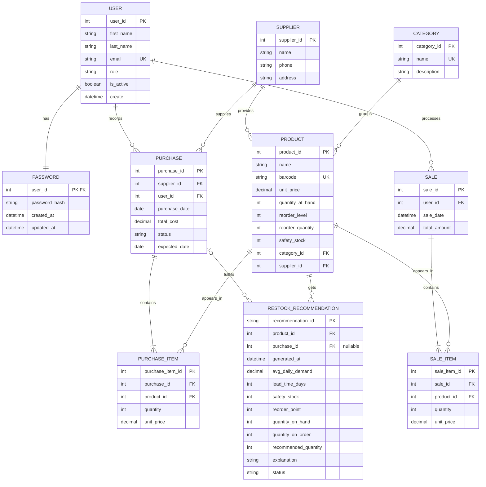

### Relationship
Supplier -> Product	(one-to-many)	A supplier provides many products, and each product has one default supplier.

Supplier -> Purchase	(one-to-many)	A supplier can receive many purchase orders.

Category -> Product	(one-to-many)	A category groups many products.

Purchase -> PurchaseItem	(one-to-many)	A purchase has at least one line item.
Sale → SaleItem	one-to-many	A sale has at least one line item.

Product -> PurchaseItem / SaleItem	(one-to-many)	A product can appear in many purchases and sales over time.

User -> Purchase / Sale	(one-to-many)	A user records many purchases and processes many sales.

User -> Password	(one-to-one) -	A user has at most one password record. The unique constraint on Password.user_id enforces this.