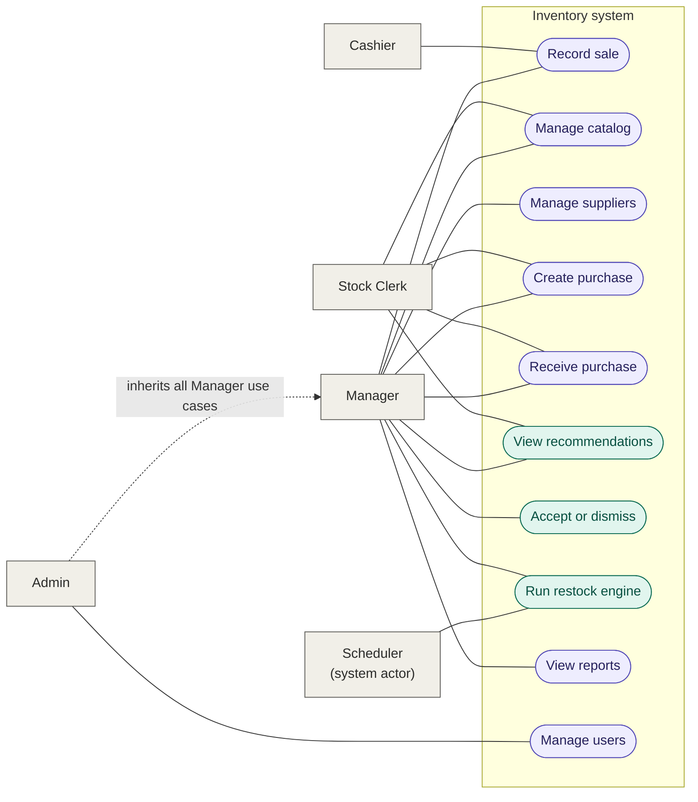

# Use case diagram

## Who can do what

| Use case | Actors |
|---|---|
| Record sale | Cashier, Manager, Admin |
| Manage catalog | Stock Clerk, Manager, Admin |
| Manage suppliers | Manager, Admin |
| Create purchase | Stock Clerk, Manager, Admin |
| Receive purchase | Stock Clerk, Manager, Admin |
| View recommendations | Stock Clerk (view only), Manager, Admin |
| Accept or dismiss | Manager, Admin |
| Run restock engine | Scheduler, Manager, Admin |
| View reports | Manager, Admin |
| Manage users | Admin |
